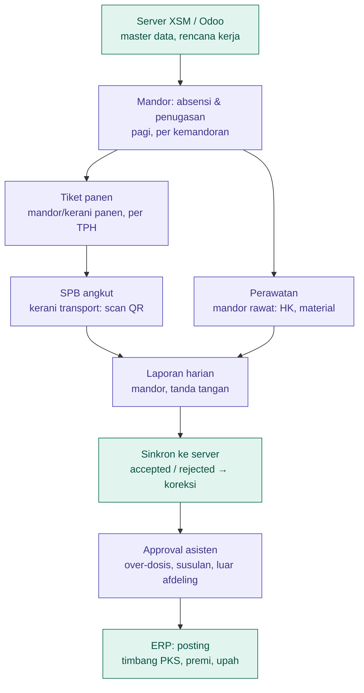

# Panduan Pengguna — Xerpium Sawit Mobile

Aplikasi lapangan untuk mandor, kerani, dan asisten kebun sawit. Semua pekerjaan dicatat di HP **tanpa perlu sinyal**,
lalu dikirim ke Xerpium ERP (Odoo) saat sinkron.

## Daftar isi

1. [Siapa memakai apa](#1-siapa-memakai-apa)
2. [Alur harian end-to-end](#2-alur-harian-end-to-end)
3. [Mulai memakai aplikasi](#3-mulai-memakai-aplikasi)
4. [Panduan per peran](#4-panduan-per-peran)
5. [Sinkron dan status data](#5-sinkron-dan-status-data)
6. [Anti-kecurangan](#6-anti-kecurangan)
7. [Masalah umum](#7-masalah-umum)
8. [Akun uji (mock server)](#8-akun-uji-mock-server)

---

## 1. Siapa memakai apa

**Mandor** memimpin orang dan pekerjaan di lapangan. **Kerani** mencatat hasil dan mengurus administrasi.
**Asisten** memeriksa dan menyetujui.

| Peran | Tugas utama | Menu yang tampil |
|---|---|---|
| Mandor panen | Absen & tugaskan pemanen, buat tiket panen, laporan harian | Absensi, Penugasan, Panen, Laporan harian, Sinkron |
| Kerani panen | Catat hasil panen per TPH, bantu absensi | Absensi, Panen, Sinkron |
| Mandor rawat | Absen & tugaskan pekerja rawat, catat perawatan & material, laporan harian | Absensi, Penugasan, Perawatan, Laporan harian, Sinkron |
| Kerani transport | Buat SPB angkut TBS ke PKS (scan QR tiket) | Transport / SPB, Sinkron |
| Asisten | Setujui / tolak / minta koreksi item yang ditandai, laporan harian | Persetujuan, Laporan harian, Sinkron |

Menu ditentukan oleh peran akun yang diatur di ERP. Semua peran juga punya menu **Akun & perangkat**.

## 2. Alur harian end-to-end

Ungu = dikerjakan di HP (bisa offline). Hijau = server / ERP.

1. **Server → HP** (di kantor / Wi-Fi). HP menarik data induk: estate, afdeling, blok, TPH, karyawan, kemandoran,
   kegiatan, aturan dosis, kendaraan. Ikut juga rencana kerja hari ini dan, untuk asisten, antrean approval.
   Jam server dipakai sebagai patokan waktu tepercaya.
2. **Pagi — mandor.** Absen anak buah (foto + GPS), lalu tugaskan pekerja ke blok sesuai rencana kerja.
3. **Siang — paralel.**
   - Mandor/kerani panen membuat **tiket panen** per TPH × pemanen.
   - Mandor rawat mencatat **perawatan** dan pemakaian material.
4. **Kerani transport** memindai QR tiket ke **SPB**, lalu truk berangkat ke PKS.
5. **Sore — mandor.** Membuat **laporan harian** dan menandatanganinya di layar.
6. **Sinkron.** Data terkirim, lalu server menerima atau menolaknya.
7. **Asisten** memutuskan item yang ditandai. Keputusannya terkirim pada sinkron berikutnya.
8. **ERP** memposting data: berat timbangan PKS dibagi ke tiket/pemanen, lalu dihitung premi dan upah.

Siklus ini berulang setiap hari.

## 3. Mulai memakai aplikasi

### Login pertama (wajib online)

1. Buka aplikasi. Bila server belum benar, ketuk **Pengaturan server** dan isi alamatnya
   (misalnya `http://192.168.1.8:8080/xsm/v1`).
2. Masukkan nama pengguna dan password ERP.
3. Buat **PIN 4–6 angka**.

### Sehari-hari

| Situasi | Yang terjadi |
|---|---|
| Buka aplikasi | Masukkan PIN. Aplikasi jalan penuh tanpa sinyal. |
| Aplikasi di latar belakang > 5 menit | Terkunci, minta PIN lagi |
| PIN salah 5× | Dikunci 30 detik, lalu bertambah lama (60, 120, … detik) |
| PIN salah 10× / lupa PIN | Wajib login online ulang dan buat PIN baru. Data di HP tetap aman. |
| Sesi server habis | Kerja offline tetap jalan; layar Sinkron meminta **Login ulang** (password saja) |
| Ganti akun / keluar | Hanya bisa bila **semua data sudah terkirim** |

### Beranda

- Indikator di atas menunjukkan **"X data belum terkirim"** atau **"Semua data terkirim"**. Ketuk untuk membuka layar Sinkron.
- Banner merah/kuning muncul bila HP di-root, GPS palsu terdeteksi, atau jam HP belum terkalibrasi.

## 4. Panduan per peran

### 4.1 Absensi (mandor, kerani panen)

Menu **Absensi**, per kemandoran.

| Aksi | Cara |
|---|---|
| Absen masuk semua | Tombol absen semua → isi alasan bila terlambat → foto grup → tersimpan |
| Per pekerja: hadir / terlambat | Ketuk pekerja → pilih status → foto dari kamera aplikasi |
| Per pekerja: sakit / izin / mangkir | Ketuk pekerja → pilih status (tanpa foto) |
| Absen pulang semua | Satu tombol, untuk pekerja yang hadir dan belum pulang |
| Kartu NFC | **Tempel kartu NFC pekerja** untuk langsung membuka absensi pekerja itu |
| Pekerja kemandoran lain | Cari nama / NIK |
| Salah input | Ubah status. Tercatat sebagai koreksi; data lama tidak dihapus. |

**Aturan:**
- Lewat jam masuk (default 06:30) otomatis berstatus **terlambat**, dan alasan wajib diisi.
- Satu pekerja hanya bisa absen di satu kemandoran per hari.
- Absen di luar batas afdeling tetap tersimpan, tetapi ditandai untuk asisten.

### 4.2 Penugasan (mandor)

Menu **Penugasan → Penugasan baru**.

1. Pilih rencana kerja hari ini, atau **Di luar rencana** (pilih kegiatan + blok dan isi alasan).
2. Pilih pekerja. Hanya pekerja yang sudah absen hadir yang bisa ditugaskan.

### 4.3 Panen (mandor panen, kerani panen)

Menu **Panen → Tiket baru**. Cukup tiga langkah:

1. Pilih **TPH**. Blok terisi otomatis dari penugasan atau rencana kerja.
2. Pilih **pemanen**. Hanya yang sudah absen hadir; bisa juga dengan menempel kartu NFC.
3. Isi **janjang matang**, lalu **Simpan tiket**.

Rincian lain bersifat opsional: mentah, busuk, janjang kosong, tangkai panjang, brondolan (kg).

**Yang dihitung otomatis:**
- **Estimasi berat** = (matang + mentah + busuk) × BJR blok.
- **Estimasi premi** dikurangi denda mentah dan tangkai panjang.
- **Nomor tiket** dibuat offline, misalnya `AFD01-261018-K3ZQ-0007`.

**Setelah disimpan:**
- Tiket menampilkan **QR** untuk dipindai kerani transport, dan bisa **dicetak** ke printer thermal.
- Tiket kedua untuk TPH + pemanen yang sama di hari yang sama otomatis ditandai **Susulan**.
- Salah input → buka tiket → **Koreksi tiket**. Akan dibuat tiket baru bernomor baru; tiket lama tetap tercatat.

**Layar daftar Panen** punya dua tampilan:
- **Per tiket**: setiap tiket dengan status *Terangkut / Belum terangkut*.
- **Per TPH**: total janjang, estimasi kg, brondolan, jumlah tiket & pemanen, dan janjang yang **belum terangkut**
  per TPH. Dipakai untuk memantau potensi restan.

### 4.4 Transport / SPB (kerani transport)

Menu **Transport / SPB → SPB baru**.

1. Pilih kendaraan, isi nama sopir, pilih tujuan (PKS sendiri / mitra).
2. Tambahkan tiket:
   - **Pindai QR** di tiket / HP mandor. Bisa dilakukan meskipun kedua HP offline.
   - Atau pilih dari daftar tiket yang belum terangkut di HP ini.
3. Ambil **minimal 2 foto** muatan.
4. Simpan. Total janjang dan kg dijumlahkan otomatis, dan nomor SPB dibuat offline.

**Aturan dan catatan:**
- Satu tiket hanya boleh masuk satu SPB aktif.
- **Langsir:** buat SPB lanjutan dari SPB induk.
- Tiket hari ini yang belum masuk SPB adalah **potensi restan**. Peringatannya berubah merah setelah jam batas (default 16:00).
- Struk SPB bisa dicetak beserta QR-nya.

### 4.5 Perawatan & material (mandor rawat)

Menu **Perawatan → Perawatan baru**.

1. Pilih kegiatan, blok, dan pekerja yang hadir.
2. Isi **HK** dan realisasi: luas (ha) atau jumlah pokok, sesuai jenis kegiatan. Foto opsional.
3. Tambahkan material (pupuk / herbisida) dan jumlahnya.

Bila jumlah melebihi **batas dosis** (dosis per ha × luas + toleransi), item ditandai **over-dosis**.
Catatan wajib diisi, dan item masuk antrean approval asisten.

### 4.6 Laporan harian (mandor, asisten)

Menu **Laporan harian → Buat laporan**.

1. Ringkasan per kemandoran terisi otomatis dari data hari ini:
   - kehadiran dan penugasan
   - panen: tiket, janjang, kg, susulan, belum terangkut
   - perawatan: HK, ha, over-dosis
2. Bubuhkan **tanda tangan** di layar, lalu simpan.

Membuat ulang laporan untuk kemandoran + tanggal yang sama dianggap koreksi laporan sebelumnya.

### 4.7 Persetujuan (asisten)

Menu **Persetujuan**. Antrean diambil saat sinkron, lalu bisa diperiksa **offline**.

1. Periksa item yang ditandai: GPS palsu, HP root, jam tidak terkalibrasi, di luar afdeling, over-dosis, susulan, dan lain-lain.
2. Putuskan: **Setujui**, **Minta koreksi**, atau **Tolak**. Catatan wajib untuk tolak dan koreksi.
3. Keputusan terkirim saat sinkron berikutnya, dan item hilang dari antrean.

### 4.8 Akun & perangkat (semua peran)

- **Alamat server**: ubah tanpa logout. Gunakan **Uji koneksi**, lalu **Simpan & sinkron**.
- **Printer Bluetooth**: scan, pilih printer thermal 58 mm, lalu cetak uji.
- **Keluar**: hanya bisa bila semua data sudah terkirim.

## 5. Sinkron dan status data

**Kapan sinkron berjalan:**
- **Manual:** menu **Sinkron → Sinkron sekarang**, atau ketuk indikator di beranda.
- **Otomatis:** saat tersambung Wi-Fi dan ada data belum terkirim.
- **Latar belakang:** kira-kira tiap jam, hanya lewat Wi-Fi.

**Satu kali sinkron mengerjakan, berurutan:**
1. Kirim transaksi.
2. Unggah foto.
3. Ambil status transaksi.
4. Perbarui data induk dan rencana kerja.
5. Kirim laporan kondisi HP.

**Status data:**

| Status | Arti |
|---|---|
| Draft / Antre | Tersimpan di HP, menunggu dikirim |
| Terkirim | Sudah dikirim; menunggu kepastian dari server |
| Diterima | Server menerima data |
| Ditolak | Server menolak; alasannya tampil. Buat **koreksi** (data baru), bukan mengubah yang lama. |
| Diposting | Sudah dibukukan di ERP |

Data yang sudah terkirim **tidak bisa diubah atau dihapus**. Perbaikan selalu berupa data koreksi baru,
sehingga riwayatnya bisa diaudit.

## 6. Anti-kecurangan

- **Foto** hanya bisa diambil dari kamera aplikasi; galeri tidak bisa dipakai. Setiap foto diberi sidik digital (SHA-256).
- **Lokasi GPS** dicatat di setiap transaksi. Lokasi palsu (*mock location*) terdeteksi dan ditandai.
- **Waktu** memakai jam server, bukan jam HP. Mengubah jam HP tidak berpengaruh.
  Setelah HP di-restart, waktu ditandai "belum terkalibrasi" sampai sinkron berikutnya.
- **HP root / emulator** terdeteksi dan ditandai.

Aplikasi **tidak memblokir** pekerjaan. Transaksi tetap tersimpan, tetapi diberi tanda dan masuk antrean asisten.

## 7. Masalah umum

| Masalah | Solusi |
|---|---|
| "Tidak terhubung ke server" saat sinkron | Pastikan HP satu jaringan dengan server. Cek **Akun & perangkat → Alamat server → Uji koneksi**. |
| Layar Sinkron minta **Login ulang** | Sesi server habis. Isi password (dan nama pengguna bila diminta). Data offline tidak hilang. |
| Pemanen / pekerja tidak muncul di daftar | Pekerja belum absen hadir hari ini. Lakukan absensi dulu. |
| Blok / TPH / pekerja baru tidak ada | Data induk belum terbaru. Lakukan sinkron di kantor. |
| Tidak bisa keluar / ganti akun | Masih ada data belum terkirim. Sinkron dulu. |
| Banner "Jam belum terkalibrasi" | Lakukan sinkron sekali saat ada koneksi. |
| Tombol NFC tidak ada | HP tidak punya NFC atau NFC dimatikan di pengaturan HP. |
| Menu Transport / SPB tidak ada | Menu hanya untuk peran kerani transport. Login dengan akun tersebut. |

## 8. Akun uji (mock server)

Untuk uji coba dengan `mock-server`. Semua akun memakai password uji yang sama, yaitu konstanta `TEST_PASSWORD`
di `mock-server/src/seed.ts`.

| Login | Nama | Peran | Afdeling |
|---|---|---|---|
| `mandor.panen` | Slamet Riyadi | Mandor panen | 1 |
| `kerani.panen` | Rina Marlina | Kerani panen | 1 |
| `mandor.rawat` | Joko Susilo | Mandor rawat | 1 |
| `kerani.transport` | Dedi Kurniawan | Kerani transport | 1, 2, 3 |
| `asisten` | Ir. Hendra Gunawan | Asisten | 1 |
| `asisten2` | Siti Aminah | Asisten | 2, 3 |

**Uji lewat kabel USB:**
1. Jalankan `adb reverse tcp:8080 tcp:8080`.
2. Isi alamat server `http://localhost:8080/xsm/v1`.

Tangkapan layar setiap menu ada di [`docs/screenshots/`](screenshots/).
